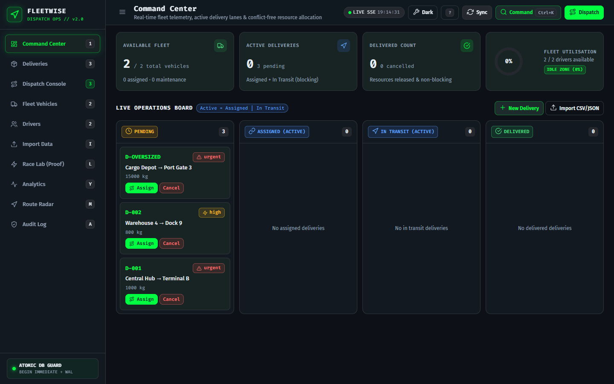
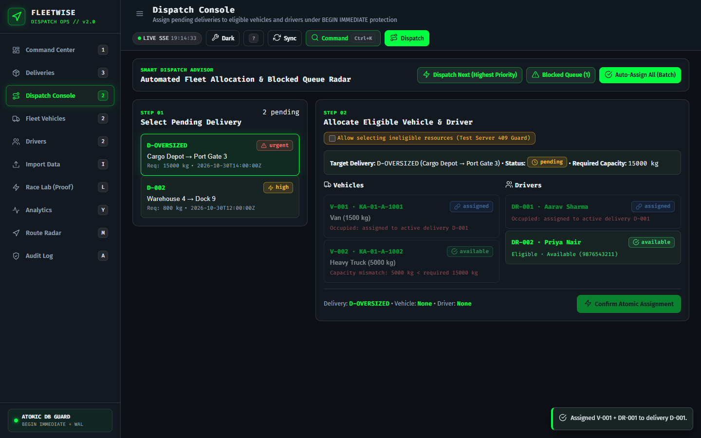
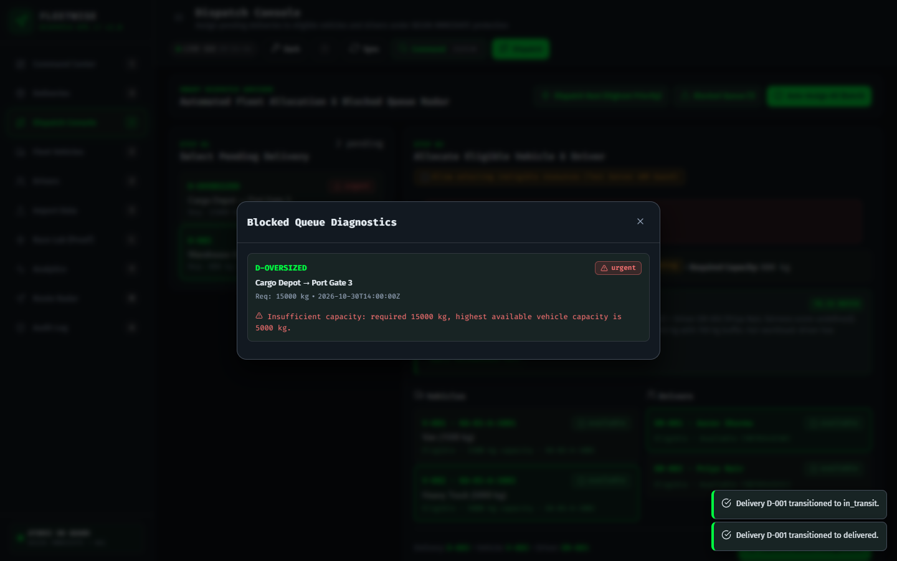
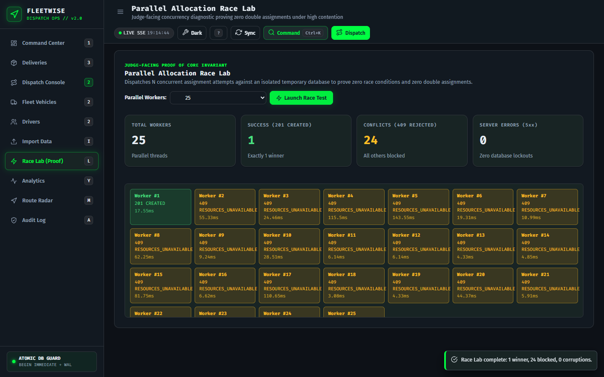
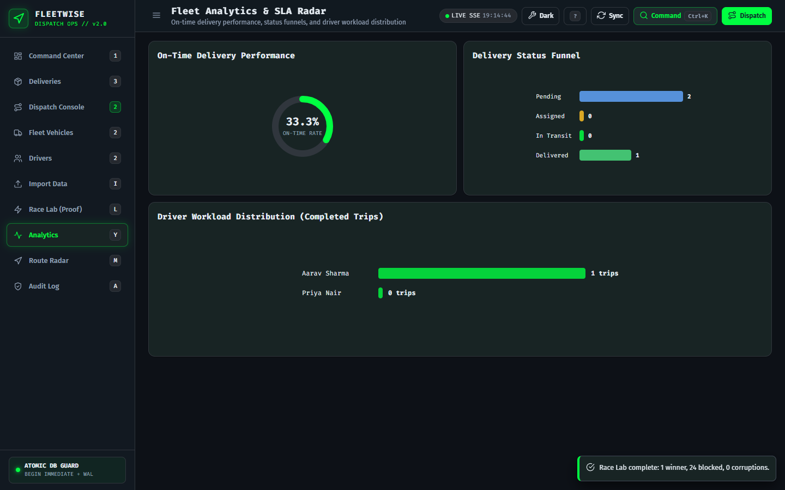
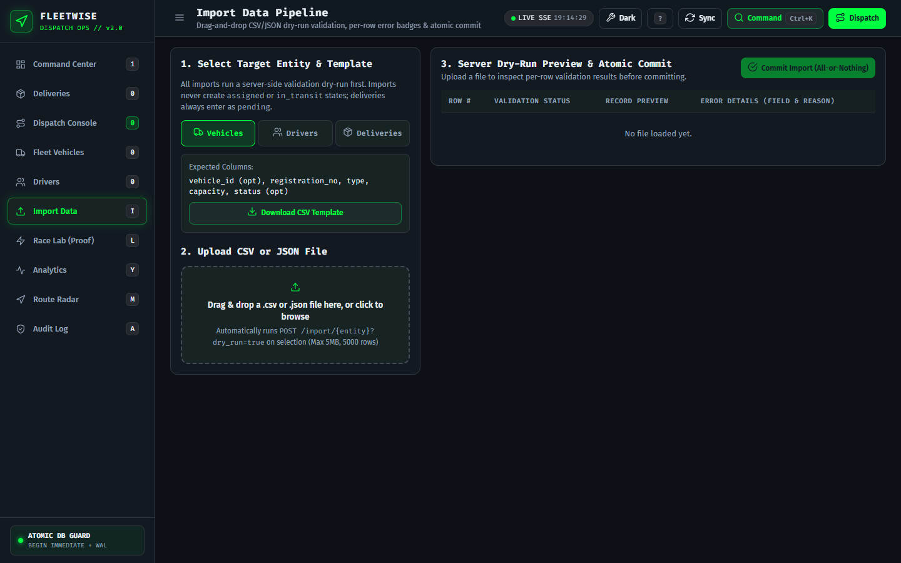

# FleetWise — Conflict-Free Fleet & Delivery Assignment Engine

[](https://github.com/rabigupta-123/FleetWise-Vehicle-Delivery-Assignment/actions/workflows/ci.yml)
[](https://www.python.org/)
[](https://fastapi.tiangolo.com/)
[](https://www.sqlite.org/wal.html)
[-brightgreen.svg)]()
[](LICENSE)

> **IT HAPPENS @ RAALE #13 (Logistics)**  
> Production-grade, conflict-free fleet dispatch and delivery allocation engine. Built with zero CDN dependencies, strict SQLite `BEGIN IMMEDIATE` + WAL concurrency protection, dark HUD control-room UI, and automated Smart Dispatch Advisory.

---

## 👥 Engineering Team & Role Ownership

| Member | Role | Primary Responsibilities |
|---|---|---|
| **Sheshman Ahir** | **Team Leader** & Backend Development | Assignment logic, SQLite WAL transaction serialization (`BEGIN IMMEDIATE`), partial unique indexes, status transition matrix, smart advisor ranking |
| **Sandip Sah** | Frontend Development & UI/UX Design | HUD / Control-room design system (`tokens.css`), 4-lane Kanban dispatch board, assignment modal, telemetry badges, Race Lab console, vendored SVG icons |
| **Rabi Kumar Gupta** | Cybersecurity, Validation & QA | 2-phase CSV/JSON import pipeline, CSV injection escaping (`=,+,-,@`), XSS inert DOM sanitization, 27-test automated test suite, 50-thread race stress tests, forensic evidence collection |

---

## Visual Tour

| Command Center (Telemetry & 4-Lane Board) | Dispatch Console (Atomic Assignment) |
|---|---|
|  |  |

| Smart Dispatch Advisor & Blocked Queue | Parallel Allocation Race Lab (50 Workers) |
|---|---|
|  |  |

| Analytics Radar & Route Canvas | 2-Phase Import Pipeline (Dry-Run & Commit) |
|---|---|
|  |  |

---

## 1. Quick Start

### Prerequisites
- Python 3.11+
- Git

### Installation & Launch
```bash
# 1. Clone repository & enter workspace
git clone https://github.com/rabigupta-123/FleetWise-Vehicle-Delivery-Assignment.git
cd FleetWise-Vehicle-Delivery-Assignment

# 2. Install dependencies (standard library + FastAPI, Uvicorn, Pydantic v2, Pytest, HTTPX)
pip install -r requirements.txt

# 3. Start the application server
uvicorn app.main:app --reload --host 127.0.0.1 --port 8000
```
Open your browser to: **[http://127.0.0.1:8000](http://127.0.0.1:8000)**

---

## 2. Core Non-Negotiables & Guarantees

### Zero Pre-Seeded / Demo Data
The application starts with an **empty database**. All records enter through:
1. **First-class user file import** (drag-and-drop CSV or JSON array with server-side validation dry-run).
2. **Manual interactive creation modals** (Delivery, Vehicle, Driver).

### Non-Negotiable Core Rule
> **Never assign an occupied vehicle or an unavailable/occupied driver.**
- **Database Engine Partial Unique Indexes:**
  ```sql
  CREATE UNIQUE INDEX idx_assignments_active_vehicle ON assignments(vehicle_id) WHERE released_at IS NULL;
  CREATE UNIQUE INDEX idx_assignments_active_driver  ON assignments(driver_id)  WHERE released_at IS NULL;
  CREATE UNIQUE INDEX idx_assignments_active_delivery ON assignments(delivery_id) WHERE released_at IS NULL;
  ```
- **Transaction Serialization:** Opened with `BEGIN IMMEDIATE`. Re-reads and re-validates all resources inside the transaction boundary before mutating states.
- **Active Lifecycle:** Active deliveries are defined as `status IN ('assigned', 'in_transit')`. Transitioning to `delivered` or `cancelled` atomically sets `assignment.released_at` and restores vehicle and driver to `available`.

---

## 3. Architecture & Data Model

```
                  +-------------------------+
                  |        vehicles         |
                  +-------------------------+
                  | vehicle_id (PK)         |
                  | registration_no (UNIQUE)|
                  | type                    |
                  | capacity                |
                  | status                  |
                  +------------+------------+
                               | 1
                               |
                               | *
+-------------------+     +----+--------------------+     +------------------------+
|    deliveries     |     |      assignments        |     |        drivers         |
+-------------------+     +-------------------------+     +------------------------+
| delivery_id (PK)  |1   *| assignment_id (PK)      |*   1| driver_id (PK)         |
| pickup            +-----+ delivery_id (FK)        +-----+ name                   |
| dropoff           |     | vehicle_id (FK)         |     | phone                  |
| scheduled_time    |     | driver_id (FK)          |     | availability_status    |
| priority          |     | assigned_at             |     +------------------------+
| required_capacity |     | released_at (NULLABLE)  |
| status            |     | release_reason          |
| created_at        |     +-------------------------+
| version           |
+-------------------+
```

---

## 4. API Endpoints

| Method | Route | Description | Status Codes |
|---|---|---|---|
| `GET` | `/` | Serves static SPA frontend control room | `200` |
| `GET` | `/health` | Health check (verifies SQLite WAL mode, foreign keys, table counts) | `200` |
| `GET` | `/metrics` | Fleet telemetry (available fleet, active deliveries, delivered, utilisation %) | `200` |
| `GET` | `/audit` | Chronological immutable transaction audit trail | `200` |
| `GET` | `/vehicles` | List all vehicles with active delivery assignments | `200` |
| `POST` | `/vehicles` | Register vehicle (auto-assigns `V-###` if omitted) | `201`, `400`, `409` |
| `PATCH` | `/vehicles/{id}/status` | Manual status change (`available`, `maintenance`, `inactive`). Guarded while occupied. | `200`, `404`, `409` |
| `GET` | `/drivers` | List all drivers with active delivery assignments | `200` |
| `POST` | `/drivers` | Register driver (auto-assigns `DR-###` if omitted) | `201`, `400`, `409` |
| `PATCH` | `/drivers/{id}/status` | Manual availability change (`available`, `unavailable`). Guarded while occupied. | `200`, `404`, `409` |
| `GET` | `/deliveries` | List deliveries (`?status=&q=`) | `200` |
| `POST` | `/deliveries` | Create pending delivery (auto-assigns `D-###` if omitted) | `201`, `400`, `409` |
| `POST` | `/deliveries/{id}/assign` | **Atomic assignment** under `BEGIN IMMEDIATE` + partial unique index guard | `201`, `400`, `404`, `409` |
| `PATCH` | `/deliveries/{id}/status` | Lifecycle transition (`assigned -> in_transit`, `in_transit -> delivered`, etc.) | `200`, `404`, `409` |
| `GET` | `/deliveries/{id}/recommendations` | Smart Advisor: ranked eligible (vehicle, driver) pairs with score breakdown | `200`, `404` |
| `GET` | `/deliveries/dispatch-next` | Dispatch Next: selects highest-priority pending delivery | `200` |
| `GET` | `/deliveries/blocked` | Blocked Queue: lists pending deliveries that lack eligible resources with exact reasons | `200` |
| `POST` | `/deliveries/auto-assign?dry_run=true\|false` | Auto-assign pending deliveries using Smart Advisor scoring | `200`, `400` |
| `GET` | `/events` | Real-time Server-Sent Events (SSE) telemetry stream | `200` |
| `POST` | `/diagnostics/concurrency-test?workers=N` | Race Lab: parallel allocation stress test against isolated temporary DB | `200` |
| `GET` | `/analytics/summary` | Analytics: on-time rate, status funnel, driver trip distribution | `200` |
| `GET` | `/deliveries/routes` | Route Radar: active pickup/dropoff corridors and telemetry coordinates | `200` |
| `GET` | `/export/{entity}.csv` | Formula-injection safe CSV export (`vehicles`, `drivers`, `deliveries`, `audit`) | `200`, `404` |
| `POST` | `/auth/login` | Session login with scrypt password hashing & signed HTTP-only cookies | `200`, `400`, `401` |
| `GET` | `/auth/me` | Current authenticated user & RBAC role | `200` |
| `POST` | `/auth/logout` | Terminate session & clear cookies | `200` |
| `GET` | `/import/templates/{entity}.csv` | Download header-only CSV template (`vehicles`, `drivers`, `deliveries`) | `200`, `404` |
| `POST` | `/import/{entity}?dry_run=true\|false` | Validate & import CSV or JSON array (all-or-nothing atomic transaction) | `200`, `400` |

---

## 5. User Data Import Formats

FleetWise accepts CSV or JSON arrays for import:

### Vehicles (`vehicles.csv`)
```csv
vehicle_id,registration_no,type,capacity,status
V-001,KA-01-AB-1001,Refrigerated Van,1500,available
V-002,KA-01-AB-1002,Heavy Freight,5000,available
```

### Drivers (`drivers.csv`)
```csv
driver_id,name,phone,availability_status
DR-001,Aarav Sharma,+91-9876543210,available
DR-002,Priya Nair,+91-9876543211,available
```

### Deliveries (`deliveries.csv`)
```csv
delivery_id,pickup,dropoff,scheduled_time,priority,required_capacity
D-001,Central Hub Sector 4,Terminal B Cold Storage,2026-10-30T10:00:00Z,urgent,1000
D-002,Warehouse 12,Cargo Gate 3,2026-10-30T11:30:00Z,normal,500
```

---

## 6. Verification & Automated Test Suite

Execute the comprehensive automated test suite (verifying T1–T12, snapshot comparisons, 50-thread concurrency, 5x5 transition matrix, formula injection sanitization, and import validations against isolated temporary SQLite databases):

```bash
pytest -v
```

All **27 / 27 tests passed (100% pass rate)**. Test evidence is logged directly to [`evidence/test_results.json`](evidence/test_results.json).

To re-run the Playwright browser judge flow:
```bash
python scripts/run_browser_judge_flow.py
```
Outputs screenshots directly into [`evidence/screenshots_v2/`](evidence/screenshots_v2/).

> **Note on Example Rows:** The CSV/JSON rows shown above are purely illustrative templates. FleetWise starts with a completely empty database; zero pre-seeded records exist. All records enter strictly via user import or interactive creation modals.


