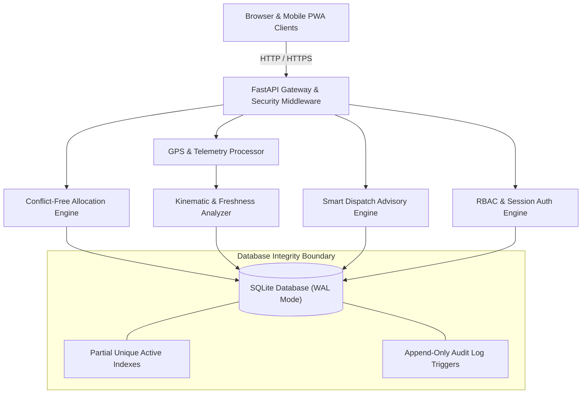
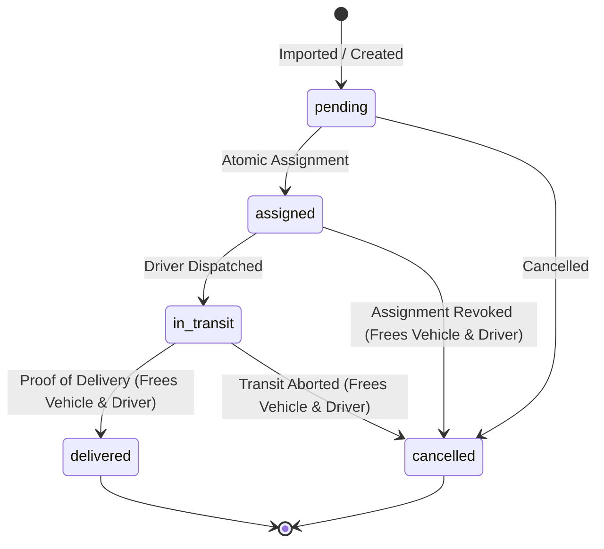
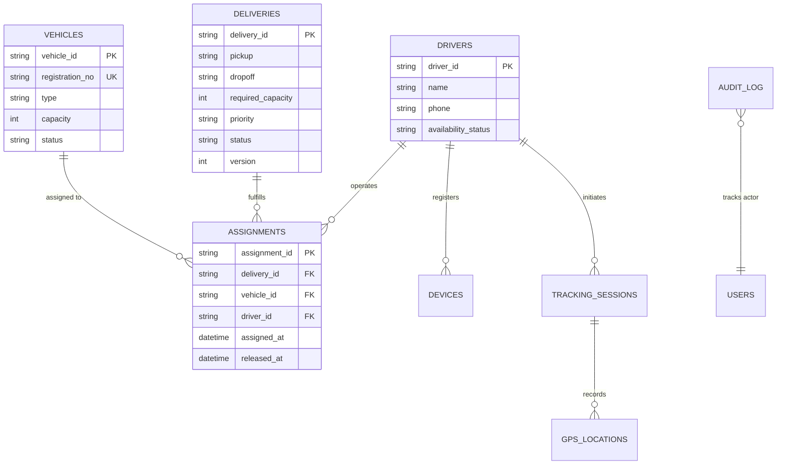

# FleetWise — Conflict-Free Fleet & Delivery Assignment Engine

[](https://github.com/rabigupta-123/FleetWise-Vehicle-Delivery-Assignment/actions/workflows/ci.yml)
[](https://www.python.org/)
[](https://fastapi.tiangolo.com/)
[](https://www.sqlite.org/wal.html)
[-brightgreen.svg)]()
[]()
[](LICENSE)

> **IT HAPPENS @ RAALE #13 (Logistics Competition)**  
> Production-grade, mathematically verified, conflict-free fleet dispatch and delivery allocation engine. Built with strict SQLite `BEGIN IMMEDIATE` transaction serialization, append-only audit triggers, zero-CDN local asset vendoring (local Leaflet & Lucide SVGs), dark control-room HUD inspired by Layers AI, automated Smart Dispatch Advisory, and verifiable physical smartphone GPS telemetry tracking under a strict Truthfulness Contract.

---

## 👥 Engineering Team & Role Ownership

| Member | Role | Core Technical Responsibilities |
|---|---|---|
| **Sheshman Ahir** | **Team Leader** & Backend Architecture | Core allocation engine, SQLite WAL concurrency (`BEGIN IMMEDIATE`), partial unique indexes, status transition matrix, smart advisor ranking |
| **Sandip Sah** | Frontend Engineering & UI/UX | HUD / Control-room design system (`tokens.css`), 4-lane Kanban dispatch board, assignment modal, telemetry badges, Race Lab console, vendored SVG icons |
| **Rabi Kumar Gupta** | Application Security, Validation & QA | 2-phase CSV/JSON import pipeline, CSV injection escaping (`=,+,-,@`), constant-time OTP verification, 62-test automated test suite, 50-thread race stress tests, forensic evidence collection |

---

## 📐 System Architecture

### 1. High-Level System Overview


### 2. Atomic Assignment Sequence
```mermaid
sequenceDiagram
    autonumber
    actor Dispatcher
    participant API as FastAPI Router
    participant Engine as Assignment Engine
    participant DB as SQLite (WAL)

    Dispatcher->>API: POST /deliveries/{id}/assign (Idempotency-Key, If-Match)
    API->>Engine: Validate Request & Headers
    Engine->>DB: BEGIN IMMEDIATE
    Note over DB: Locks write-lock exclusively; re-reads delivery, vehicle, driver states
    DB-->>Engine: Current Resource States
    alt Any resource occupied or delivery not pending
        Engine->>DB: ROLLBACK
        Engine-->>Dispatcher: 409 Conflict (Error Envelope)
    else Capacity insufficient
        Engine->>DB: ROLLBACK
        Engine-->>Dispatcher: 400 Validation Error (Overcapacity)
    else Valid & Conflict-Free
        Engine->>DB: INSERT INTO assignments(...)
        Engine->>DB: UPDATE vehicles SET status = 'assigned'
        Engine->>DB: UPDATE drivers SET availability_status = 'assigned'
        Engine->>DB: UPDATE deliveries SET status = 'assigned'
        Engine->>DB: INSERT INTO audit_log(...)
        Engine->>DB: COMMIT
        Engine-->>Dispatcher: 201 Created (Assignment Record)
    end
```

### 3. Delivery Lifecycle State Machine


### 4. Database Entity-Relationship Diagram


---

## 📸 Visual Tour

| Command Center (Telemetry & 4-Lane Board) | Dispatch Console (Atomic Assignment) |
|---|---|
|  |  |

| Smart Dispatch Advisor & Blocked Queue | Parallel Allocation Race Lab (50 Workers) |
|---|---|
|  |  |

| Analytics Radar & Route Canvas | 2-Phase Import Pipeline (Dry-Run & Commit) |
|---|---|
|  |  |

---

## 🔒 Core Non-Negotiables & Guarantees

### 1. Truthfulness Contract
- **No Fabricated Data**: Starting from an empty database, every endpoint and analytics card returns empty/null/zero. No hardcoded mock arrays or fake scores.
- **Strict Device Battery States**: Resolved strictly from browser-reported values into 4 deterministic states:
  - `unavailable`: API missing in browser.
  - `error`: Query promise rejects.
  - `measured`: Confirmed physical battery readings.
  - `measured_suspect`: Desktop Chromium defaults (`level=1`, `charging=true`, `chargingTime=0`, `dischargingTime=Infinity`) labeled as *"browser-reported, unverified"*.
- **Physical Host Power Separation**: Server machine power is isolated under `/system/host-power` in a dedicated server ops card, never mixed with client device batteries.

### 2. Conflict-Free Assignment Engine
- **Partial Unique Indexes in SQLite**:
  ```sql
  CREATE UNIQUE INDEX idx_assignments_active_vehicle ON assignments(vehicle_id) WHERE released_at IS NULL;
  CREATE UNIQUE INDEX idx_assignments_active_driver  ON assignments(driver_id)  WHERE released_at IS NULL;
  CREATE UNIQUE INDEX idx_assignments_active_delivery ON assignments(delivery_id) WHERE released_at IS NULL;
  ```
- **Transaction Serialization**: Every state mutation executes inside an atomic `BEGIN IMMEDIATE` transaction that re-reads current status before assigning, preventing race conditions even under 50 simultaneous concurrent threads.
- **Append-Only Audit Log**: Enforced via SQLite triggers forbidding `UPDATE` and `DELETE` on the `audit_log` table.

---

## 🧮 Mathematical Formulas & Formulations

All mathematical formulas, coordinate geometries, and confidence heuristics are fully documented in [docs/FORMULAS.md](docs/FORMULAS.md).

### Key Formulations:
1. **Haversine Great-Circle Distance ($R = 6\,371\,000.0\text{ m}$)**:
   $$a = \sin^2\left(\frac{\Delta \phi}{2}\right) + \cos(\phi_1)\cos(\phi_2)\sin^2\left(\frac{\Delta \lambda}{2}\right), \quad d = R \cdot 2 \operatorname{atan2}\left(\sqrt{a}, \sqrt{1-a}\right)$$
2. **Kinematic Velocity & Jump Detection**:
   $$v_{\text{derived}} = \frac{d}{\Delta t}, \quad v_{\text{km/h}} = v_{\text{derived}} \times 3.6 \quad (\text{jump if } v > 50\text{ m/s})$$
3. **Capacity Suitability**:
   $$\text{Score} = 100.0 - \left(\frac{C - W}{C} \times 20.0\right) \quad (\text{strictly } 0.0 \text{ if } W > C)$$
4. **Telemetry Freshness Decay**:
   $$Q_{\text{freshness}} = 100.0 \times \exp\left(-\frac{\Delta t_{\text{age}}}{300.0}\right) \quad (\text{LIVE } < 90\text{s}, \text{STALE } 90\text{--}300\text{s}, \text{OFFLINE } > 300\text{s})$$

---

## 🚀 Quick Start

### Prerequisites
- Python 3.12+
- Git
- Node.js 20+ (for browser telemetry state tests)

### 1. Installation
```bash
# Clone the repository
git clone https://github.com/rabigupta-123/FleetWise-Vehicle-Delivery-Assignment.git
cd FleetWise-Vehicle-Delivery-Assignment

# Install runtime dependencies
pip install -r requirements.txt

# Install development & test dependencies (optional, for running linters and tests)
pip install -r requirements-dev.txt
```

### 2. Launch Dual Server
```bash
# Serves standard HTTP on :8000 and HTTPS on :8443 concurrently
python scripts/run_dual_server.py
```
- **Desktop Control Room**: [http://127.0.0.1:8000](http://127.0.0.1:8000)
- **Mobile Smartphone GPS Portal**: `https://<lan-ip>:8443` (Required for W3C Geolocation Secure Context)
- **Device Diagnostics Probe**: [http://127.0.0.1:8000/probe](http://127.0.0.1:8000/probe)

---

## 🧪 Test Suite & Quality Status

<!-- BEGIN:TEST_COUNTS -->
**64 Passed** / **64 Total** (100% pass rate)
<!-- END:TEST_COUNTS -->

### Running the Complete Test & Quality Suite:
```bash
# 1. Run Secrets Scan
python scripts/check_secrets.py

# 2. Run Ruff Linter
ruff check app tests

# 3. Run Pyrefly Static Type Checker
pyrefly check --min-severity=warn

# 4. Run KaTeX Math Syntax Validation
python scripts/check_math_syntax.py

# 5. Run Node.js Battery Truthfulness Unit Tests
node --test tests/test_battery_states.test.js

# 6. Run Full Pytest Integration Suite
pytest -v --junitxml=junit.xml

# 7. Check Documentation Synchronization
python scripts/update_readme.py --check
```

---

## 📡 API Reference Table

The following routes are generated directly from the running FastAPI application:

<!-- BEGIN:API_ROUTES -->
| Method | Route Path | Description |
|:---:|:---|:---|
| `GET` | `/` | Operational endpoint |
| `GET` | `/analytics/accuracy` | Calculates granular Telemetry Quality Scores across active tracking sessions. |
| `GET` | `/analytics/anomalies` | Retrieves operational and kinematic anomalies detected across telemetry and events. |
| `GET` | `/analytics/confidence` | Calculates Evidence Confidence Scores across device identity and active fleet assignments. |
| `GET` | `/analytics/deliveries` | Comprehensive delivery completion and on-time performance breakdown. |
| `GET` | `/analytics/drivers` | Driver utilization and individual performance metrics. |
| `GET` | `/analytics/drivers/{driver_id}` | Detailed operational metrics and delivery performance for a single driver. |
| `GET` | `/analytics/fleet` | Fleet utilization breakdown and operational performance per vehicle. |
| `GET` | `/analytics/overview` | Executive operational overview combining fleet, driver, and delivery KPIs. |
| `GET` | `/analytics/summary` | Operational endpoint |
| `GET` | `/analytics/telemetry` | Aggregated telemetry volume, quality distribution, and kinematics statistics. |
| `GET` | `/analytics/vehicles/{vehicle_id}` | Detailed operational metrics and telemetry stats for a single vehicle. |
| `GET` | `/audit` | Operational endpoint |
| `POST` | `/auth/login` | Operational endpoint |
| `POST` | `/auth/logout` | Operational endpoint |
| `GET` | `/auth/me` | Operational endpoint |
| `GET` | `/deliveries` | Operational endpoint |
| `POST` | `/deliveries` | Operational endpoint |
| `POST` | `/deliveries/auto-assign` | Operational endpoint |
| `GET` | `/deliveries/blocked` | Operational endpoint |
| `GET` | `/deliveries/dispatch-next` | Operational endpoint |
| `GET` | `/deliveries/routes` | Operational endpoint |
| `POST` | `/deliveries/{delivery_id}/assign` | Atomically assign a vehicle and driver to a pending delivery. |
| `GET` | `/deliveries/{delivery_id}/recommendations` | Operational endpoint |
| `PATCH` | `/deliveries/{delivery_id}/status` | Operational endpoint |
| `GET` | `/devices` | Operational endpoint |
| `GET` | `/devices/probe-reports` | Retrieves list of captured device probe reports. |
| `POST` | `/devices/register` | Operational endpoint |
| `GET` | `/devices/{device_id}` | Operational endpoint |
| `PATCH` | `/devices/{device_id}/rename` | Operational endpoint |
| `POST` | `/devices/{device_id}/revoke` | Operational endpoint |
| `GET` | `/devices/{device_id}/telemetry` | Operational endpoint |
| `POST` | `/diagnostics/concurrency-test` | Executes N parallel assignment attempts against an ISOLATED temporary database |
| `GET` | `/drivers` | Operational endpoint |
| `POST` | `/drivers` | Operational endpoint |
| `PATCH` | `/drivers/{driver_id}/phone` | Operational endpoint |
| `POST` | `/drivers/{driver_id}/phone/request-verification` | Operational endpoint |
| `POST` | `/drivers/{driver_id}/phone/verify` | Operational endpoint |
| `PATCH` | `/drivers/{driver_id}/status` | Operational endpoint |
| `GET` | `/events` | Operational endpoint |
| `GET` | `/export/{entity}.csv` | Operational endpoint |
| `GET` | `/health` | Operational endpoint |
| `GET` | `/import/templates/{entity}.csv` | Operational endpoint |
| `POST` | `/import/{entity}` | Operational endpoint |
| `GET` | `/metrics` | Operational endpoint |
| `GET` | `/network-info` | Operational endpoint |
| `GET` | `/probe` | Operational endpoint |
| `POST` | `/probe/report` | Stores client device capability and battery diagnostics probe report. |
| `GET` | `/system/host-power` | Returns server host physical power telemetry (Win32 kernel GetSystemPowerStatus / psutil). |
| `GET` | `/tracking/deliveries/{delivery_id}/latest` | Operational endpoint |
| `GET` | `/tracking/drivers/{driver_id}/latest` | Operational endpoint |
| `GET` | `/tracking/history` | Operational endpoint |
| `POST` | `/tracking/location` | Operational endpoint |
| `POST` | `/tracking/sessions/start` | Operational endpoint |
| `POST` | `/tracking/sessions/stop` | Operational endpoint |
| `GET` | `/tracking/telemetry-graph` | Operational endpoint |
| `GET` | `/tracking/vehicles/{vehicle_id}/latest` | Operational endpoint |
| `GET` | `/vehicles` | Operational endpoint |
| `POST` | `/vehicles` | Operational endpoint |
| `PATCH` | `/vehicles/{vehicle_id}/status` | Operational endpoint |
<!-- END:API_ROUTES -->

---

## 📄 License

This project is licensed under the MIT License — see the [LICENSE](LICENSE) file for details.
